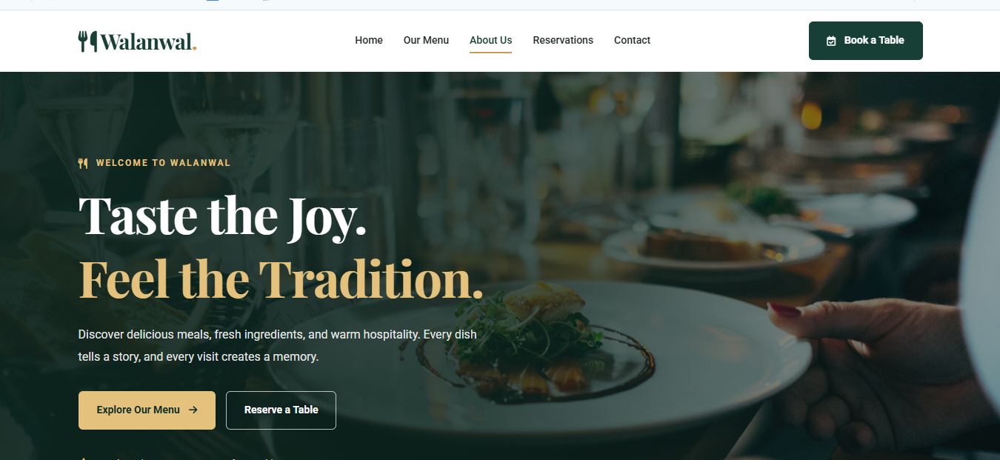

# 🍽️ Walanwal Restaurant Website

**A Modern, Responsive, and Elegant Restaurant Website**

Welcome to the Walanwal Restaurant Website repository! This project is a modern restaurant website designed to provide customers with an attractive online experience where they can explore the restaurant, discover its menu, learn about the business, and find reservation and contact information.

---

## 📌 Project Overview

Walanwal Restaurant is a front-end web development project built with HTML, CSS, and JavaScript. It focuses on clean design, responsive layouts, user-friendly navigation, and professional restaurant branding.

The website includes multiple pages to help visitors explore restaurant information and navigate between important sections.

## ✨ Features

- 🏠 **Home Page** — Welcoming hero section and restaurant introduction.
- 🍴 **Menu Page** — A dedicated page for displaying restaurant dishes.
- 👨‍🍳 **About Page** — Information about the restaurant and its story.
- 📅 **Reservations Page** — A form interface for requesting table reservations.
- 📩 **Contact Page** — Contact information and a customer message form.
- 📱 **Responsive Design** — Layouts designed for desktop, tablet, and mobile screens.
- 🧭 **Navigation Menu** — Consistent navigation across the website.
- 🎨 **Modern UI** — Elegant typography, restaurant imagery, and a coordinated color palette.
- ⚡ **JavaScript Interactions** — Mobile navigation and basic front-end form interactions.
- 🔗 **Social Media Links** — Space for the restaurant's social media profiles.

## 🛠️ Technologies Used

| Technology | Purpose |
|---|---|
| HTML5 | Website structure and content |
| CSS3 | Styling, layouts, and responsive design |
| JavaScript | Interactive navigation and front-end form behavior |
| Google Fonts | Typography |
| Font Awesome | Icons |

## 📂 Project Structure

```text
walanwal-restaurant/
│
├── index.html
├── menu.html
├── about.html
├── reservations.html
├── contact.html
│
├── css/
│   ├── style.css
│   ├── responsive.css
│   ├── reservations.css
│   └── contact.css
│
├── js/
│   └── main.js
│
├── images/
│   └── restaurant images
│
└── README.md
```

## 🚀 Getting Started

Follow these steps to run the project locally.

### 1. Clone the Repository

```bash
git clone YOUR_GITHUB_REPOSITORY_URL
```

Replace `YOUR_GITHUB_REPOSITORY_URL` with your actual GitHub repository URL.

### 2. Open the Project Folder

```bash
cd walanwal-restaurant
```

### 3. Run the Website

Open `index.html` in your browser.

For a better development experience, you can use the **Live Server** extension in Visual Studio Code.

1. Open the project folder in VS Code.
2. Install the Live Server extension if you have not installed it.
3. Right-click `index.html`.
4. Select **Open with Live Server**.

## 📸 Screenshots



Example:

```text
screenshots/
├── home.png
├── menu.png
├── about.png
├── reservations.png
└── contact.png
```

Then add the following Markdown to display your screenshots:

### Home Page


### Menu Page


### About Page


### Reservations Page


### Contact Page


*Note: Add the screenshot files to the repository using the filenames shown above, or update the image paths to match your actual files.*

## 📱 Responsive Design

The website is designed to adapt to different screen sizes, including:

- Desktop computers
- Laptops
- Tablets
- Mobile phones

Responsive CSS helps keep the navigation, forms, content, and layout usable on smaller screens.

## ⚠️ Current Limitations

This project is primarily a front-end website.

- The reservation form does not yet store bookings in a database.
- The contact form does not yet send messages to an email address.
- Real restaurant contact information, social links, and map location should be configured before launch.
- External fonts, icons, and remote images may require an internet connection.

A backend or an appropriate third-party service is required for real booking and message processing.

## 🔮 Future Improvements

- [ ] Connect the reservation form to a backend.
- [ ] Add database storage for reservations.
- [ ] Enable contact form email delivery.
- [ ] Add a real Google Maps location.
- [ ] Add a dynamic menu management system.
- [ ] Improve accessibility and form validation.
- [ ] Optimize images and website performance.
- [ ] Deploy the website to a live hosting platform.

## 👨‍💻 Developer

**Project:** Walanwal Restaurant Website

**Developer:** Add Your Name

**Role:** Front-End Web Developer

## 📄 License

This project is intended for educational and portfolio purposes. Add a suitable open-source license if you plan to distribute or reuse the project publicly.

---

<p align="center">
  <strong>Walanwal Restaurant</strong><br>
  Good Food. Great Moments.
</p>
